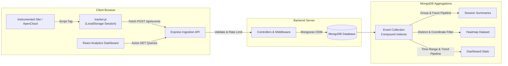

# CausalFunnel - Full-Stack User Analytics Platform

A production-grade, full-stack User Analytics Application built for the Full Stack Engineer hiring assignment at **CausalFunnel**.

The platform features a **lightweight, standalone client tracking script (`tracker.js`)**, high-throughput **Node.js/Express event ingestion**, **MongoDB aggregation pipelines**, an interactive **Click Heatmap engine** (with coordinate density mapping, live page overlays, and an accessible tabular click list), **multi-website support (`site_id`)**, **time-range filtering**, and a **modern SaaS Analytics Dashboard** inspired by the clarity and polish of Linear, Stripe, and PostHog.

---

## Table of Contents

1. [Project Overview](#project-overview)
2. [Key Features](#key-features)
3. [Technology Stack](#technology-stack)
4. [Architecture & Data Flow](#architecture--data-flow)
5. [Folder Structure](#folder-structure)
6. [Prerequisites](#prerequisites)
7. [Installation & Setup](#installation--setup)
8. [Environment Configuration](#environment-configuration)
9. [Running the Application](#running-the-application)
10. [Client-Side Tracking Script (`tracker.js`)](#client-side-tracking-script-trackerjs)
11. [Multi-Website Tracking Architecture](#multi-website-tracking-architecture)
12. [Coordinate System Documentation](#coordinate-system-documentation)
13. [Testing Event Tracking with ApexCloud Demo Site](#testing-event-tracking-with-apexcloud-demo-site)
14. [API Endpoint Documentation](#api-endpoint-documentation)
15. [MongoDB Schema, Indexes & Aggregation](#mongodb-schema-indexes--aggregation)
16. [Security & Optimization Features](#security--optimization-features)
17. [Automated Testing & Build Status](#automated-testing--build-status)
18. [Assumptions and Trade-Offs](#assumptions-and-trade-offs)
19. [Limitations](#limitations)
20. [Deployment & GitHub Instructions](#deployment--github-instructions)

---

## Project Overview

CausalFunnel Analytics captures and visualizes user behavior across digital web properties without relying on heavy third-party SDKs. 

- **Autonomous Client Tracking**: Embed `tracker.js` via a single `<script>` tag. It automatically handles session persistence across browser reloads, deduplicates initialization page views, captures click interactions with document coordinates and screen viewports, and gracefully handles network issues.
- **Multi-Website Support (`site_id`)**: Register multiple web properties, tag incoming events with unique `site_id` slugs, generate tailored embed snippets, and filter all dashboard views (Overview, Sessions, Heatmap) per website.
- **High-Performance Ingestion Backend**: Built with Express and Mongoose, featuring strict schema validations, IP rate limiting, ReDoS-safe query escaping, payload protection, and multi-key compound indexes.
- **Real-Time SaaS Dashboard**: Clean, minimal interface featuring KPI statistics, time-range controls (24h, 7d, 30d, all), chronological session journeys with coordinate badges, and an interactive click heatmap with triple-mode visualization (Document Coordinate Canvas, Page Preview Overlay, and Click List Table).
- **Standalone Demo SaaS Website (`ApexCloud`)**: A realistic cloud infrastructure landing page with interactive CTAs, terminal deploy console, feature provisioning triggers, pricing calculators, and a discreet floating tracking widget.

---

## Key Features

- **Zero-Dependency Tracking Library (`tracker.js`)**:
  - Independent of React or any framework (pure vanilla JS).
  - Generates and persists unique session IDs in `localStorage` (`cf_session_id`).
  - Automatic `page_view` capturing with single-run deduplication guard.
  - Global `click` event listener with document-space coordinate calculation (`pageX`, `pageY`) and screen viewport capture (`window.innerWidth`, `window.innerHeight`).
  - SPA navigation detection (hooks into `pushState`, `replaceState`, and `popstate`).
  - Uses `fetch` with `keepalive: true` to prevent dropped requests on page exit.
  - Configurable API URL and Site ID via `data-api-url` / `data-site-id` script attributes or `window.__ANALYTICS_CONFIG__`.

- **Comprehensive Multi-Website Backend API**:
  - `POST /api/sites` & `GET /api/sites`: Register and list website properties with aggregate session and event stats.
  - `POST /api/events`: Ingests and validates event types, URLs, timestamps, session IDs, site IDs, viewports, and coordinates.
  - `GET /api/events/stats`: Aggregates KPIs, activity trend, event composition, and top pages with `site_id` and `time_range` filtering.
  - `GET /api/sessions`: Paginated list of sessions with total events, page views, clicks, and activity timestamps computed via MongoDB `$group` and `$facet` aggregation.
  - `GET /api/sessions/:sessionId/events`: Chronological user journey timeline with 404 handling.
  - `GET /api/heatmap/pages`: Distinct URLs with recorded clicks filtered by `site_id`.
  - `GET /api/heatmap?url=...&site_id=...`: Click coordinate array, viewport data, session IDs, and total count.
  - `GET /api/health`: Database and API uptime status check.
  - `POST /api/seed` & `DELETE /api/seed`: 1-click test data generator and database reset (with production environment guards).

- **Modern SaaS Dashboard**:
  - **Overview**: Real-time KPI cards, time-range filter (24h, 7d, 30d, all), Recharts activity area chart, event distribution donut chart, recent sessions list, and top visited pages.
  - **Sessions & User Journeys**: Searchable, paginated sessions table with ReDoS-safe search. Clicking any session opens an accessible chronological modal distinguishing page views and clicks with coordinate tags (Escape key support).
  - **Interactive Heatmap**: Triple-mode visualization (Document Coordinate Canvas, Page Preview Overlay, and Click List Table). Includes viewport device filtering (Desktop, Tablet, Mobile), zoom scaling (100%, 75%, 50%), and direct session drilldown.
  - **Interactive Demo Website (`/demo`)**: Standalone SaaS landing page for ApexCloud with interactive CTAs, terminal deploy simulation, pricing calculators, FAQ accordion, and floating CausalFunnel tracking pill.

---

## Technology Stack

| Layer | Technologies |
|---|---|
| **Frontend** | React 18, Vite 6, Tailwind CSS, React Router v7, Recharts, Lucide Icons, Axios |
| **Backend** | Node.js (v22+), Express.js 4 (ES Modules `"type": "module"`), Express Rate Limit, Morgan, Dotenv |
| **Database** | MongoDB with Mongoose ODM 8 |
| **Client Tracker**| Pure Vanilla JavaScript (ES6+), Fetch API, LocalStorage |
| **Testing** | Vitest, Supertest (20 integration tests) |

---

## Architecture & Data Flow



---

## Folder Structure

```
d:/web assignment 2026/
├── client/                      # Frontend React + Vite application
│   ├── public/
│   │   └── tracker.js           # Reusable standalone tracking library
│   ├── src/
│   │   ├── components/
│   │   │   ├── Header.jsx       # Top navigation, site selector, & status
│   │   │   ├── Sidebar.jsx      # Dark SaaS sidebar with DB status & nav
│   │   │   ├── SessionDetailModal.jsx # User journey timeline modal (Accessible)
│   │   │   └── AddSiteModal.jsx # Register website & generate snippet modal
│   │   ├── pages/
│   │   │   ├── Overview.jsx     # Overview KPIs, time-range filter, & charts
│   │   │   ├── Sessions.jsx     # Searchable paginated session table
│   │   │   ├── Heatmap.jsx      # Canvas, Overlay & Click List heatmap
│   │   │   └── Demo.jsx         # Standalone ApexCloud SaaS landing page
│   │   ├── services/
│   │   │   └── api.js           # Centralized Axios API service client
│   │   ├── App.jsx              # Routing, layout branching, & health checks
│   │   ├── index.css            # Tailwind directives & design tokens
│   │   └── main.jsx             # React entry point
│   ├── index.html               # HTML template loading fonts & tracker.js
│   ├── vite.config.js           # Vite configuration
│   ├── tailwind.config.js       # Tailwind configuration
│   ├── package.json
│   ├── .env.example
│   └── .env
├── server/                      # Backend Node.js + Express API
│   ├── src/
│   │   ├── config/
│   │   │   └── db.js            # Mongoose connection & lifecycle handlers
│   │   ├── controllers/
│   │   │   ├── siteController.js    # Website registration & list
│   │   │   ├── eventController.js   # Event ingestion & dashboard stats
│   │   │   ├── sessionController.js # Aggregated sessions & journey
│   │   │   ├── heatmapController.js # Distinct pages & click coordinates
│   │   │   ├── healthController.js  # Server & DB health monitor
│   │   │   └── seedController.js    # Demo data simulation & reset
│   │   ├── middleware/
│   │   │   ├── validate.js      # Strict payload validation & ReDoS escape
│   │   │   ├── rateLimiter.js   # IP-based rate limiting
│   │   │   └── errorHandler.js  # Centralized error & 404 handlers
│   │   ├── models/
│   │   │   ├── Site.js          # Mongoose schema for registered websites
│   │   │   └── Event.js         # Mongoose schema with compound indexes
│   │   ├── routes/
│   │   │   ├── siteRoutes.js
│   │   │   ├── eventRoutes.js
│   │   │   ├── sessionRoutes.js
│   │   │   ├── heatmapRoutes.js
│   │   │   ├── healthRoutes.js
│   │   │   └── seedRoutes.js
│   │   ├── app.js               # Express application configuration
│   │   └── server.js            # HTTP server bootstrap & graceful shutdown
│   ├── tests/
│   │   └── api.test.js          # Automated Vitest test suite (20 tests)
│   ├── package.json
│   ├── .env.example
│   └── .env
├── package.json                 # Root workspace scripts
├── .env.example                 # Root environment reference
├── .gitignore                   # Git ignore file
└── README.md                    # Project documentation
```

---

## Prerequisites

- **Node.js**: v18.0.0 or higher (v22+ recommended)
- **npm**: v9.0.0 or higher
- **MongoDB**: Local MongoDB community server (listening on `127.0.0.1:27017`) or a MongoDB Atlas URI

Verify installation:
```bash
node -v
npm -v
```

---

## Installation & Setup

Install dependencies for both backend and frontend:

```bash
# 1. Install Server Dependencies
cd server
npm install

# 2. Install Client Dependencies
cd ../client
npm install

# Return to project root
cd ..
```

---

## Environment Configuration

### Backend Configuration (`server/.env`)
Create `server/.env` (or copy from `server/.env.example`):
```env
PORT=5000
MONGODB_URI=mongodb://127.0.0.1:27017/user_analytics
CLIENT_URL=http://localhost:5173
NODE_ENV=development
```

### Frontend Configuration (`client/.env`)
Create `client/.env` (or copy from `client/.env.example`):
```env
VITE_API_URL=http://localhost:5000/api
```

---

## Running the Application

### Option A: Run Both Services from Project Root
From the root folder, run:
```bash
npm run dev
```
*(Runs both Express backend on port 5000 and Vite dev server on port 5173 concurrently).*

### Option B: Run Services in Separate Terminals

**Terminal 1 (Backend Server):**
```bash
cd server
npm run dev
# Server will start on http://localhost:5000
```

**Terminal 2 (Frontend Client):**
```bash
cd client
npm run dev
# Vite will launch on http://localhost:5173
```

Open your browser to **`http://localhost:5173`** to access the dashboard.

---

## Client-Side Tracking Script (`tracker.js`)

The tracking script is located at `client/public/tracker.js`. It can be embedded into any website:

```html
<!-- Reusable Tracking Embed -->
<script 
  defer 
  src="http://localhost:5173/tracker.js" 
  data-site-id="your_site_slug" 
  data-api-url="http://localhost:5000/api">
</script>
```

### Configuration Options
1. **Script Attributes**: `data-api-url` and `data-site-id` on the `<script>` tag.
2. **Global Config Object**:
   ```javascript
   window.__ANALYTICS_CONFIG__ = {
     apiUrl: 'http://localhost:5000/api',
     siteId: 'my_custom_site',
     debug: true
   };
   ```

### Event Payload Schema
- **Page View**:
  ```json
  {
    "site_id": "cf_demo_site",
    "session_id": "session_2z61fw78_mv4t5dku",
    "event_type": "page_view",
    "page_url": "http://localhost:5173/demo",
    "timestamp": "2026-10-12T11:15:25.000Z",
    "coordinates": null,
    "viewport": { "width": 1440, "height": 900 }
  }
  ```
- **Click**:
  ```json
  {
    "site_id": "cf_demo_site",
    "session_id": "session_2z61fw78_mv4t5dku",
    "event_type": "click",
    "page_url": "http://localhost:5173/demo",
    "timestamp": "2026-10-12T11:16:10.000Z",
    "coordinates": { "x": 420, "y": 280 },
    "viewport": { "width": 1440, "height": 900 }
  }
  ```

---

## ApexCloud Dedicated Website Configuration (`cf_demo_site`)

For the assignment evaluation, the analytics platform is configured specifically to track and display **only the ApexCloud demo website**:

1. **Configured Property Identifier**: `cf_demo_site` (name: *ApexCloud Demo*).
2. **Target Tracking Route**: `http://localhost:5173/demo`.
3. **Dashboard Self-Tracking Prevention**: `tracker.js` includes an intelligent route guard (`isTrackableUrl`) that ensures only user interactions on `/demo` are captured. Navigation within the analytics dashboard (`/`, `/sessions`, `/heatmap`) is explicitly excluded, preventing recursive self-analytics contamination.
4. **Focused Dashboard Interface**: The header has been streamlined by replacing the multi-site switcher with an active property badge (`ApexCloud Demo [cf_demo_site]`). The underlying multi-site REST APIs (`POST /api/sites`, `GET /api/sites`) and multi-tenant schema remain fully intact and backward-compatible.
5. **Unified Dashboard Filtering**: The Overview KPI statistics, activity charts, session lists, session journey event timelines, and click heatmap all query and display telemetry exclusively for `cf_demo_site` without deleting existing records.

---

## Coordinate System Documentation

- **Document Space (`pageX`, `pageY`)**: `tracker.js` records `event.pageX` and `event.pageY`. This measures the exact pixel coordinate relative to the top-left of the entire HTML document, regardless of current scroll position.
- **Why Document Coordinates?**: Viewport-relative coordinates (`clientX`, `clientY`) change depending on how far the user has scrolled down the page, which breaks heatmaps on tall pages. By using document coordinates, clicks remain locked to the actual elements clicked.
- **Visualization Matching**:
  - The **Document Coordinate Canvas** renders an HTML5 canvas matching the document dimensions with radial glow gradients centered at `(x, y)`.
  - The **Page Preview Overlay** loads the live page inside an iframe with the click canvas superimposed on top.
  - The **Click List Table** provides an accessible tabular coordinate view displaying exact pixel coordinates, viewport dimensions, device categories, and timestamps.

---

## Testing Event Tracking with ApexCloud Demo Site

1. Open **`http://localhost:5173/demo`**.
2. ApexCloud is styled as a standalone, modern cloud SaaS product (independent navigation bar, hero section, interactive CLI deploy tabs, bare-metal compute cards, pricing calculator, and FAQ accordion).
3. Every button, tab, and card click is captured in real time by `tracker.js` and persisted to MongoDB.
4. A subtle floating badge in the bottom-right corner displays your live click count and coordinates.
5. Click **"Analytics Dashboard"** in the top navigation or **"Inspect"** in the tracking pill to view your interactions in the dashboard.

---

## API Endpoint Documentation

### 1. `POST /api/sites` & `GET /api/sites`
- `GET /api/sites`: Returns all registered websites with session and event counts.
- `POST /api/sites`: Registers a new website with `site_id`, `name`, and `domain`.

### 2. `POST /api/events`
Ingests and validates a user tracking event.

**Payload:**
```json
{
  "site_id": "cf_demo_site",
  "session_id": "session_unique_string",
  "event_type": "page_view",
  "page_url": "http://localhost:5173/demo",
  "timestamp": "2026-10-12T10:00:00.000Z",
  "coordinates": null,
  "viewport": { "width": 1440, "height": 900 }
}
```

### 3. `GET /api/events/stats`
Returns aggregated analytics metrics with optional `site_id` and `time_range` (`24h`, `7d`, `30d`, `all`).

**Response (200 OK):**
```json
{
  "success": true,
  "data": {
    "site_id": "all",
    "time_range": "24h",
    "totalSessions": 7,
    "totalEvents": 252,
    "totalPageViews": 62,
    "totalClicks": 190,
    "activityTrend": [
      { "time": "2026-10-12 11:00", "events": 45, "page_views": 10, "clicks": 35 }
    ],
    "topPages": [
      { "url": "http://localhost:5173/demo", "total_events": 206, "page_views": 50, "clicks": 156 }
    ],
    "recentSessions": [...]
  }
}
```

### 4. `GET /api/sessions`
Returns paginated session summaries sorted by most recent activity.
- Query parameters: `page`, `limit`, `search`, `site_id`.

### 5. `GET /api/sessions/:sessionId/events`
Returns all events belonging to a session in chronological order.

### 6. `GET /api/heatmap/pages`
Returns distinct page URLs with recorded clicks for the selected website.

### 7. `GET /api/heatmap?url=PAGE_URL&site_id=...`
Returns click coordinates, viewports, session IDs, and total count.

### 8. `GET /api/health`
Health check for server uptime, environment, and MongoDB connection status.

### 9. `POST /api/seed` & `DELETE /api/seed`
- `POST /api/seed`: Generates realistic test browsing sessions and clicks.
- `DELETE /api/seed`: Clears events (protected by `NODE_ENV` / `x-admin-key` in production).

---

## MongoDB Schema, Indexes & Aggregation

### Schema Definition
```javascript
const eventSchema = new mongoose.Schema({
  site_id: { type: String, required: true, default: 'cf_demo_site', index: true },
  session_id: { type: String, required: true, index: true },
  event_type: { type: String, required: true, enum: ['page_view', 'click'] },
  page_url: { type: String, required: true },
  timestamp: { type: Date, required: true, default: Date.now },
  coordinates: {
    type: {
      x: { type: Number, required: true, min: 0 },
      y: { type: Number, required: true, min: 0 }
    },
    default: null
  },
  viewport: {
    type: {
      width: { type: Number, min: 0 },
      height: { type: Number, min: 0 }
    },
    default: null
  }
});
```

### Database Compound Indexes
- `{ site_id: 1, session_id: 1, timestamp: 1 }`: Optimized chronological user journey queries.
- `{ site_id: 1, timestamp: -1 }`: Rapid sorting for dashboard stats and recent feeds.
- `{ site_id: 1, page_url: 1, event_type: 1 }`: Fast heatmap retrieval without full-collection scans.

---

## Accessibility & Ease-of-Use Enhancements (WCAG 2.1 AA)

1. **Navigation Structure**:
   - **Desktop Sidebar**: High-contrast, clean sidebar with clearly labeled navigation items (`Overview`, `Sessions`, `Heatmap`, `Demo Site`, and `Settings`), clear active indicators (`aria-current="page"`), and visible focus rings.
   - **Mobile Bottom Navigation**: Fixed bottom navigation bar on mobile (`< lg`) with 48px touch targets, active icon + text badges, and `aria-current="page"`.
   - **Accessible Drawer**: Mobile hamburger toggle opens a slide-over navigation drawer with backdrop dismissal, close button, and `role="dialog"`.
   - **Breadcrumbs & Page Titles**: Top header displays accessible breadcrumbs (`ApexCloud > [Page]`) and dynamic page subtitles.
   - **Skip Link**: Top-level `<a href="#main-content">Skip to main content</a>` for keyboard screen reader users.

2. **Filters & Date Range Controls**:
   - **Prominent Date Filter Bar**: Positioned directly below the title banner across all analytics pages.
   - **Readable Quick Filters**: `Today`, `Yesterday`, `Last 7 Days`, `Last 30 Days`, `This Month`, `Last Month`, `This Year`, `Last Year`, `All Time`, and `Custom Range`.
   - **Independent Grouping**: `Group by` selector (`Hour`, `Day`, `Month`, `Year`, `Auto`) separated from the date-range presets.
   - **Non-Destructive Reset Filters**: Visible **Reset Filters** button restores filters back to default without touching database records.
   - **Destructive Reset Data Separation**: Destructive telemetry wipe is placed in a separate header action styled in distinct rose colors with an explicit modal confirmation dialog explaining what will be deleted and what will be preserved.
   - **Responsive Wrapping**: Filter buttons wrap cleanly on narrow screens (down to 320px) without causing horizontal page scrolling.

3. **Readability & Assistive Technology Support**:
   - **Client Timezone Detection**: Automatically queries the client's local timezone (`Intl.DateTimeFormat().resolvedOptions().timeZone`, e.g. `Asia/Kolkata`) and feeds it into MongoDB aggregation pipelines so charts and timestamps accurately reflect local hours.
   - **Accessible Form Elements**: All inputs have explicitly associated labels via `htmlFor` and `id` (e.g. search input, rows-per-page select, radius slider, viewport filter).
   - **Modal Dialog Accessibility**: All modals (`ResetConfirmationModal`, `SettingsModal`, `SessionDetailModal`, `CustomDateModal`) feature `role="dialog"`, `aria-modal="true"`, `aria-labelledby`, visible focus traps, and keyboard `Escape` closing.
   - **Accessible Announcements**: Live stream updates and toasts announce state using `role="status"` and `aria-live="polite"`.
   - **Reduced Motion Support**: Implements `@media (prefers-reduced-motion: reduce)` in CSS, automatically disabling transitions and animations for users sensitive to motion.
   - **Consistent Visible Focus**: Global `:focus-visible` styling (`outline: 2px solid #0d9488; outline-offset: 2px`).

4. **Multi-Viewport Responsive Verification**:
   - **320 × 568 (Small Mobile / iPhone SE)**: Zero unintended horizontal page overflow; mobile bottom nav easily accessible; cards stack cleanly; tables scroll within dedicated containers.
   - **375 × 812 (Standard Mobile / iPhone X)**: Filter buttons wrap comfortably; heatmap controls stack into accessible groups; modals fit viewport.
   - **768 × 1024 (Tablet / iPad)**: Balanced 2-column KPI grid and responsive charts.
   - **1440 × 900 (Desktop)**: Full desktop sidebar, 4-column KPI cards, side-by-side area and donut charts, real-time telemetry stream table.

---

## Automated Testing & Build Status

### Backend Integration Tests (Vitest & Supertest)
```bash
cd server
npm test
```

**Actual Verified Output:**
```
 RUN  v2.1.9 D:/web assignment 2026/server

stdout | tests/api.test.js
[MongoDB] Connected successfully to host: 127.0.0.1, database: user_analytics_test
[MongoDB] Default website "cf_demo_site" created.

 ✓ tests/api.test.js (24 tests) 580ms

 Test Files  1 passed (1)
      Tests  24 passed (24)
   Duration  2.25s
```

### Frontend Production Build (Vite)
```bash
cd client
npm run build
```

**Actual Verified Output:**
```
vite v6.4.4 building for production...
✓ 2273 modules transformed.
dist/index.html                   1.24 kB │ gzip:   0.72 kB
dist/assets/index-Cgf5Q2Y1.css   44.92 kB │ gzip:   7.81 kB
dist/assets/index-DGritzWY.js   769.91 kB │ gzip: 219.30 kB
✓ built in 9.94s
```

---

## Assumptions and Trade-Offs

1. **Authentication**: In accordance with the assignment specifications, authentication is intentionally not enforced to facilitate immediate evaluation and demo testing.
2. **Heatmap Page Overlay**: Due to modern browser cross-origin security (`X-Frame-Options` and CSP), rendering arbitrary external websites inside an `<iframe>` underlay can be blocked. The platform provides a dedicated **Document Coordinate Canvas** and a **Click List Table** as the reliable default visualization modes.
3. **Session Identification**: Unique session IDs are generated on the client via timestamp + cryptographically random entropy and stored in `localStorage` under `cf_session_id`.

---

## Limitations

- **Cross-Domain Iframe Preview**: Heatmap Page Preview overlay relies on iframe loading. If an instrumented third-party website sets `X-Frame-Options: DENY`, use the **Coordinate Canvas** or **Click List Table** view modes.
- **Serverless Ingestion**: Built on Node.js/Express with MongoDB. For hyper-scale production (>50,000 requests/sec), an ingestion buffer such as Redis or Kafka would be placed in front of MongoDB writes.

---

## Deployment & GitHub Instructions

### Push to GitHub
```bash
git add .
git commit -m "feat: complete full-stack user analytics platform upgrade"
git branch -M main
git remote add origin https://github.com/YOUR_USERNAME/causalfunnel-analytics.git
git push -u origin main
```
